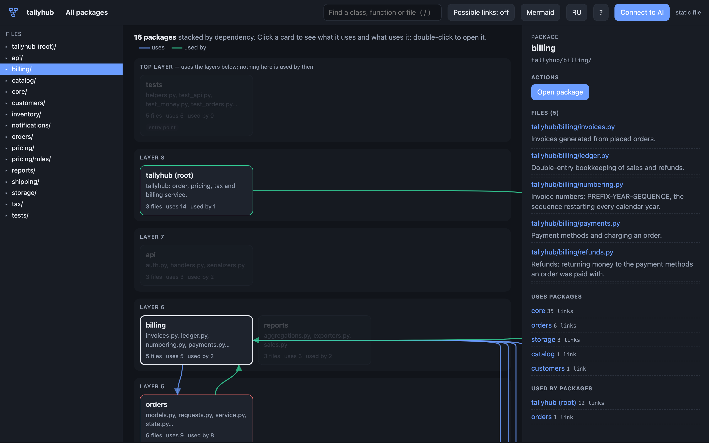
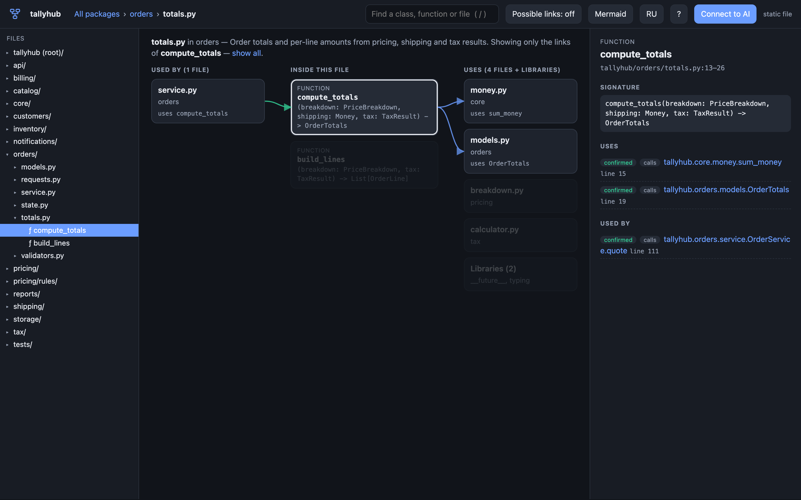
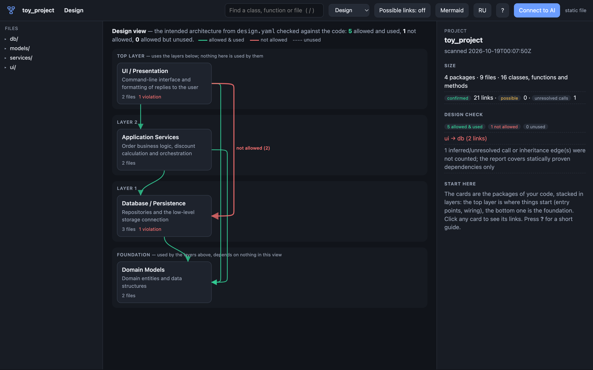

# Method Project Map — user guide

[Русская версия](guide.ru.md) · [Back to README](../README.md) · [Method Network](https://method-network.com/)

This guide covers installing Method Project Map, reading the map, checking architecture, connecting AI agents and every command. The map itself has the same material built in: press **?** for the reference or take the one-minute tour.

- [1. Install](#1-install)
- [2. First start](#2-first-start)
- [3. Reading the map](#3-reading-the-map)
- [4. Projects and what goes on the map](#4-projects-and-what-goes-on-the-map)
- [5. Checking architecture with design.yaml](#5-checking-architecture-with-designyaml)
- [6. AI agents](#6-ai-agents)
- [7. Sharing a map](#7-sharing-a-map)
- [8. Command reference](#8-command-reference)
- [9. Troubleshooting](#9-troubleshooting)
- [10. Uninstall](#10-uninstall)

## 1. Install

You need **Python 3.9 or newer** to run the tool, whatever language your project is in. Python projects need nothing else. For TypeScript / JavaScript, Go, Java, Kotlin, C#, Swift, Dart, Rust and C / C++ the installer downloads the tree-sitter grammars (about 15 MB from PyPI) into its own environment, `~/.pmap/venv`; `--python-only` skips that, and `pmap langs install` adds it later.

```bash
git clone https://github.com/lstcrsdd/method-project-map.git
cd method-project-map
```

| | macOS / Linux | Windows |
|---|---|---|
| Install and connect Claude Code (default) | `./install.sh` | `install.bat` |
| Install and connect Codex | `./install.sh --codex` | `install.bat --codex` |
| Install and connect every agent (Claude Code, Codex, Gemini CLI) | `./install.sh --all` | `install.bat --all` |
| Install without connecting any agent | `./install.sh --none` | `install.bat --none` |
| Skip the grammars for other languages | add `--python-only` | add `--python-only` |

The installer:

1. copies the tool to `~/.pmap` and creates the `pmap` command in `~/.pmap/bin` (`pmap.cmd` on Windows);
2. creates a **Method Project Map** shortcut:
   - macOS: `~/Applications/Method Project Map.app` (found by Spotlight and Launchpad);
   - Windows: an entry in the Start menu;
   - Linux: an entry in the application menu (`~/.local/share/applications/method-project-map.desktop`);
3. connects the AI agent you chose (see [section 6](#6-ai-agents)).

Optional: add `~/.pmap/bin` to your `PATH` to type just `pmap`.

**Without installing.** You can also run the map straight from the downloaded folder: double-click `Method Project Map.command` (macOS) or `pmap-ui.bat` (Windows), or run `./pmap-ui.sh` (Linux, macOS).

## 2. First start

Open the **Method Project Map** shortcut or run `pmap ui`.

- The first time, a folder dialog asks which project to show (Finder on macOS, Explorer on Windows, the desktop's dialog on Linux).
- Later starts open the last project straight away.
- The map opens in your browser. A one-minute tour is offered on the first visit; you can take it again at any time with **?** → **Take the 1-minute tour**.
- Starting the shortcut again does not start a second copy: it opens the map that is already running.
- The map stops by itself about 15 minutes after its browser tab is closed.

On macOS the first start of the shortcut may ask whether *Method Project Map* may read files in the project folder (for example on an external disk). Allow it once.

To open a particular project from a terminal: `pmap ui /path/to/project`.

## 3. Reading the map



### Three levels

| Level | A card is | Shows |
|---|---|---|
| **Overview** | a package (folder of code) | all packages, stacked in layers |
| **Package** | a file of that package | the files in layers, plus the packages it uses and is used by |
| **File** | a class or function | three columns: who uses the file · what is inside · what it uses |

- **Click** a card to select it and see its links.
- **Double-click** it, or press **Open** in the side panel, to go inside.
- The path at the top (*All packages › billing › invoices.py*), `Esc` or `Backspace` take you one level up.
- The **Files** tree on the left jumps to any package, file, class or function.

### Layers

Cards are stacked by dependency:

- the **top layer** uses the layers below and nothing uses it: entry points, command line, tests;
- the **foundation** at the bottom depends on nothing in view: models, utilities, the core;
- the layers in between build on the ones under them.

When code at the bottom uses code at the top, the design usually deserves a closer look.

### Arrows and colours

Arrows are drawn **only for the selected card**, so the picture stays readable:

- **blue** — what the selected item uses;
- **green** — what uses the selected item;
- a card with a **red** frame both uses the selection and is used by it (a cycle);
- **dashed amber** — a possible link (see below).

Cards that are not related to the selection fade. Click an empty spot to clear the selection.

### Inside a file



The left column lists the files that use this file, the middle one its classes, functions and methods, the right one the files it uses (libraries are folded into one card). Click a function or method to keep only **its own** callers and callees; **show all** brings the whole file back.

### Confirmed, possible and unresolved links

The map never presents a guess as a fact. Every link has a confidence level:

| Label | Meaning | What to do |
|---|---|---|
| **confirmed** (`resolved`) | proven from the code: a direct import, a call of an imported function, a base class, a method of a typed variable's class that no subclass overrides | rely on it |
| **possible** (`inferred`) | likely but not proven: a call through an interface, protocol or trait, a method a subclass overrides, a Python annotation, a variable assigned in several places | check it in the code; hidden by default, turn on **Possible links** |
| **unresolved** | the target is unknown | listed in the side panel as *Calls the map could not resolve*; read the code |

The analysis is static and closed-world: it does not see calls from code outside the repository, functions replaced at run time (monkey-patching) or lookups by name with `getattr`.

### Links between languages

A mobile or desktop app often spans several languages: a Flutter UI in Dart, Swift for Apple platforms, Kotlin or Java for Android, C++ for Windows, a Rust core. They call each other through **names no compiler checks**: a platform-channel name and method name, a C symbol, a JNI function name. The map links both sides:

- **Flutter platform channels**: a Dart `invokeMethod('connect')` goes to the branch that handles `"connect"` in Swift (`case "connect":`), Kotlin (`"connect" ->`), Java and C++ (`method_name() == "connect"`); native code calling back into Dart, event channels (`receiveBroadcastStream` to `onListen`) and message channels too.
- **C ABI (FFI)**: `dart:ffi` lookups and `@Native`, and calls from Swift, C/C++ and Go, go to the `#[no_mangle]` Rust function or the C definition with that symbol.
- **JNI**: Kotlin `external fun` and Java `native` methods go to their `Java_…` functions.
- **Generated bindings**: Pigeon (a call through the generated Dart API goes to the app's Swift, Kotlin or Java implementation), flutter_rust_bridge, UniFFI, Tauri commands.
- **System hand-offs** (possible links, the system decides): NetworkExtension `startVPNTunnel` to the tunnel provider's `startTunnel`, Android `startService(Intent(…))` to the service's `onStartCommand`.

In the map these are ordinary links marked as bridges, with where they land on the other side: packages of different languages are joined on the overview, the side panel says *via channel app.vpn/control "connect" → macos/Runner/VpnChannel.swift:24*, and the overview panel lists every channel and kind of link.

A **gap** is a channel method called from one side that a platform handling the channel does not handle — for example, Dart asks for `status` and the Kotlin handler has no branch for it. On that platform the call fails at run time. A call inside a platform check (`if (Platform.isIOS)`, `TargetPlatform.android`) counts only for the platforms it names. Gaps are shown first in the overview panel and listed by `pmap check .`.

### Side panel

The right panel describes the selection: what it is (the first line of its docstring), its signature, what it contains, what it uses and who uses it, with line numbers. Buttons:

- **Open** — go inside;
- **Show source** — the code of just this function or class (live map only);
- **Show in Finder / Explorer** — the file in your file manager (live map only).

### Search and keys

| Key | Action |
|---|---|
| `/` | search classes, functions, methods and files |
| `↑` `↓` `Enter` | choose and open a search result |
| `Esc`, `Backspace` | one level up; close a window |
| `→` `←` `Esc` | next, back and end in the tour |

### Language

**RU / EN** in the header switches the interface language; the choice is remembered. Descriptions taken from the code (docstrings) stay as written.

## 4. Projects and what goes on the map

Click the **project name** at the top left to:

- choose another folder in Finder / Explorer;
- paste the full path of a project folder;
- reopen one of the recent projects;
- show the current project folder in Finder / Explorer.

Any folder with source code works. A home folder or a whole disk is refused: choose one project.

**Languages.** Python is built in. TypeScript / JavaScript, Go, Java, Kotlin, C#, Swift, Dart, Rust and C / C++ need the grammars (`pmap langs` shows what is installed, `pmap langs install` adds the rest). Languages can be mixed in one project; the project panel lists them and flags any that are not on the map. What the map follows:

| Language | Imports and names | Calls |
|---|---|---|
| TypeScript / JavaScript | relative paths, `tsconfig` / `jsconfig` `baseUrl` and `paths`, `index` files, re-exports (`export * from`), monorepo packages by name, `require()` | functions and classes, `new X()`, JSX `<Component />`, methods through typed parameters, fields and `new` |
| Go | `go.mod` module paths, aliases, all files of a package | package functions, struct literals, methods (exact for concrete types, possible through interfaces), embedding |
| Java / Kotlin | package declarations, single, wildcard and static imports, same-package classes, Kotlin aliases and top-level functions | static and instance methods, constructors, implicit `this`, typed fields and locals |
| C# | namespaces (block and file-scoped) and their parents, `using`, `using static`, `global using`, aliases | static and instance methods, constructors, implicit `this`, typed fields, properties and locals |
| Swift | the module's files (SwiftPM target or Xcode folder), `import` of other modules | types, `init`, methods incl. extensions, protocols, implicit `self`, typed properties and locals |
| Dart / Flutter | `package:` and relative imports, `export` barrels, `as` prefixes, `show`, `part` files | constructors and widgets, methods incl. extensions and mixins, implicit `this`, closures with typed parameters |
| Rust | crates, workspaces, `mod` files, `use` with `crate::` / `self::` / `super::`, `pub use` | functions, `Type::new()`, methods from `impl` blocks and traits, `Self`, typed `let`, `?` and `unwrap()` |
| C / C++ | `#include` (next to the file or by path suffix), namespaces, `using namespace` | functions and methods, `Type::m` defined in a .cpp, constructors, `obj.m()` / `ptr->m()` on typed variables |

Ids of non-Python code use the file path: `sym:src/billing/invoice.ts:InvoiceService.issue`.

**Import roots.** Projects with a `src/` layout are detected automatically. For other layouts run `pmap scan . --root DIR` once (repeat `--root` for several roots): the saved map remembers them.

**Leaving code out.** Generated or third-party (vendored) code can drown the real structure. Put a `.pmapignore` file in the project root:

```text
# one glob per line; a trailing / leaves out a whole folder
vendor/
generated/
*_pb2.py
```

**Freshness.** The live map watches the files and refreshes itself when they change. A saved map (`.pmap/actual.json` from `pmap scan`) is used only while it matches the files on disk; otherwise the project is rescanned. A stale map is never shown silently.

## 5. Checking architecture with design.yaml

Write down the intended architecture and let the map check the real code against it (the *Reflexion model*, Murphy & Notkin, 1995).

Put `design.yaml` in the project root (`.pmap/design.yaml` and `pmap.design.yaml` also work):

```yaml
pmf_version: "0.1.0"
kind: "design"
project:
  name: "shop"
  description: "Order service with a layered architecture"

subsystems:
  - id: "ui"
    name: "User interface"
    paths: ["app/ui/**"]
  - id: "services"
    name: "Business logic"
    paths: ["app/services/**"]
  - id: "db"
    name: "Database"
    paths: ["app/db/**"]
  - id: "models"
    name: "Domain models"
    paths: ["app/models/**"]

allowed_dependencies:
  - from: "ui"
    to: "services"
  - from: "ui"
    to: "models"
  - from: "services"
    to: "db"
  - from: "services"
    to: "models"
  - from: "db"
    to: "models"
```

- `subsystems` — the parts of the system; `paths` are globs relative to the project root.
- `allowed_dependencies` — which subsystem may use which. Everything else is forbidden.

The map then gets an **Architecture** view:



- **green** — allowed and used (*convergence*);
- **red** — used but not allowed (*divergence*), with the file and line it comes from;
- **dotted** — allowed but unused (*absence*).

In a terminal or CI:

```bash
pmap check .              # report
pmap check . --json       # machine-readable report
pmap check . --strict     # exit code 1 when there are violations (for CI)
```

Only confirmed links count. Imports made only for type checking (`if TYPE_CHECKING:`) are left out unless you pass `--include-type-only`.

A working example lives in [`examples/`](../examples): `pmap serve examples/toy_project --design examples/design.yaml --open` shows one deliberate violation (`ui → db`).

### Gaps between languages in CI

`pmap check .` also checks the links between languages, with or without a `design.yaml`: every channel method that some platform does not handle is reported with the file and line on both sides, and `--strict` makes the command fail on it. Without a design, only this part runs.

### An mDm scheme instead of design.yaml

A project designed in [mDm](https://method-network.com/) has `PROJECT.mdm` in its root: a functional scheme of functions and the objects they take (`из:`) and give (`в:`). Once a function is built, the coding agent writes under it where it lives:

```text
2 Подобрать слот
  из: Заявка, Расписание мастера
  в: Бронь
  код: app/booking/slots/
```

Without a `design.yaml` the map checks the code against this scheme (`pmap check .`, or explicitly `pmap check . --design PROJECT.mdm`). Functions and objects with `код:` become subsystems. Whatever the scheme wires together is allowed: a function uses its objects; functions joined by an object, and a function with its subfunctions, use each other. Anything else is a violation: a wire in the code that the scheme does not have. Functions without `код:` are listed in a warning. Details: [the specification](../spec/PMF-v0.md), section 4.1.

## 6. AI agents

Agents waste much of their context reading files just to find their way. Method Project Map gives them the map instead.

### What connecting does

**Connect to AI** in the map, the installer, or `pmap connect` set up:

| | Claude Code | Codex |
|---|---|---|
| Skill `project-map` (how to use the map) | `~/.claude/skills/project-map/` | `~/.codex/skills/project-map/` |
| Overview of the project at the start of each session | `SessionStart` hook in `~/.claude/settings.json` | `SessionStart` hook in `~/.codex/hooks.json` |
| Note after each edit: what depends on the changed code | `PostToolUse` hook in `~/.claude/settings.json` | `PostToolUse` hook in `~/.codex/hooks.json` |
| Rule to look at the map before reading files | `~/.claude/CLAUDE.md` | `~/.codex/AGENTS.md` |
| MCP server `pmap` | registered with `claude mcp add --scope user` | `~/.codex/config.toml` |

Every change is a marked block; each config file is backed up as `<name>.bak-pmap` before the first change. **Disconnect** (or `pmap disconnect --all`) removes exactly these additions. Codex runs new hooks only after you trust them: open `/hooks` in Codex once and trust the two `pmap` hooks.

The hook works only in code projects (it looks for `.git`, `pyproject.toml`, `package.json`, `go.mod`, `pom.xml`, `build.gradle`, `*.csproj` and similar, or for a folder with Python packages). It stays silent elsewhere, in the home folder and on any error.

### As a plugin

Instead of `pmap connect` you can install the plugin from this repository (it bundles the skill, the hook, the MCP server and the `pmap` command):

```text
# Claude Code
/plugin marketplace add lstcrsdd/method-project-map
/plugin install project-map@method-project-map

# Codex
codex plugin marketplace add lstcrsdd/method-project-map
codex plugin add project-map
```

Use either the plugin or `pmap connect --claude`, not both: each adds the session-start overview.

### What the agent gets

**After each edit**, a short note on what depends on the code the agent just changed: callers in other files and the other side of every link between languages, with file and line. For an edit inside a function body it is one line; when the edit touches a declaration's head, or deletes it, every user is listed. It says nothing when nothing outside the file depends on the change and never repeats itself within a session:

```text
Method Project Map — code elsewhere depends on what you just changed; keep it in step:
vpn_core_start (rust/src/ffi.rs:15)
  ← windows/runner/vpn_channel.cpp:18  VpnChannel::HandleMethodCall  (C/C++, C ABI vpn_core_start)
  ← macos/Runner/TunnelController.swift:8  TunnelController.connect  (Swift, C ABI vpn_core_start)
```

The note comes from a cached map (`~/.pmap/cache`), refreshed in the background after every edit, so it costs well under a second.

**At the start of a session**, a compact overview (about 4,000 characters): languages, the links between them and any gaps, then packages with their purpose and dependencies, files with one-line descriptions and signatures — the most widely used code first. In a large project that has no map yet, the map is built in the background and the overview arrives with the next session. Then precise queries:

| Need | Command | MCP tool |
|---|---|---|
| Overview | `pmap context . --max-chars 8000` | `pmap_overview` |
| Where is a class or function (also suggests near names) | `pmap find NAME` | `pmap_find` |
| One item: location, signature, links, users | `pmap show REF` | `pmap_show` |
| The code of one function or class instead of a whole file | `pmap source REF` | `pmap_source` |
| Architecture check | `pmap check .` | `pmap_check` |
| What changed since the saved scan | `pmap stale .` | `pmap_stale` |
| Save a fresh map | `pmap scan .` | `pmap_scan` |

`REF` is a node id (`sym:pkg.module:Class.method`, `mod:pkg.module`), a file path or a qualified name. The rules agents follow are in [AGENT_PROTOCOL.md](AGENT_PROTOCOL.md).

### Does it help?

On a 29,000-line project with hidden tests, Codex fixed 60 of 60 bugs both with and without the map. With the overview in the prompt it read **0.55×** as much code (95% CI 0.49–0.59) and wrote 0.85× as many output tokens; total input tokens were 0.93× (CI 0.83–1.02, not significant). So the overview alone saves reading, not money, and finding the right file was not the hard part: the agent opened it with its second command either way. Agents that were only *told* about the commands almost never used them, in the benchmark and in real sessions. That is why the map now speaks up after edits instead, where a change can stop halfway: in another file, or on the other side of a link between languages. A benchmark of tasks that cross languages is next. Details: [bench/reports](../bench/reports).

## 7. Sharing a map

```bash
pmap html /path/to/project -o map.html
```

writes one self-contained page: no server, no internet, works from a file or any static hosting. It is a snapshot: project switching, source and *Show in Finder* need the live map.

Useful address options for a published page:

| Address | Effect |
|---|---|
| `map.html?lang=en` / `?lang=ru` | interface language |
| `map.html?tour=0` | do not offer the tour |
| `map.html#select=pkg:app/billing` | open with a package selected |
| `map.html#open=mod:app.billing.invoices` | open a file |
| `map.html#open=sym:app.billing.invoices:Invoice` | open a class or function |
| `map.html#view=design` | open the Architecture view |

`pmap mermaid . --level subsystem|module` and the **Mermaid** button export diagrams as Mermaid text for documentation.

## 8. Command reference

All commands: `pmap <command> --help`.

| Command | What it does | Main options |
|---|---|---|
| `pmap ui [FOLDER]` | open the map: the folder, else the last project, else ask | `--port` |
| `pmap serve [FOLDER]` | the live map for development; runs until stopped | `--open`, `--port`, `--host`, `--design` |
| `pmap html [FOLDER]` | save a self-contained page | `-o FILE`, `--design` |
| `pmap scan FOLDER` | save the map to `.pmap/actual.json` | `--root DIR` (repeatable), `--output` |
| `pmap context FOLDER` | text overview for an AI agent | `--max-chars N`, `--design` |
| `pmap find NAME` | find classes, functions, methods | `--repo`, `--limit` |
| `pmap show REF` | one node with links and users | `--repo` |
| `pmap source REF` | source of one node | `--repo`, `--context N` |
| `pmap check FOLDER` | compare with `design.yaml`; list gaps between languages | `--design`, `--json`, `--strict`, `--include-type-only` |
| `pmap stale FOLDER` | changed since the last scan | `--json` |
| `pmap mermaid FOLDER` | Mermaid diagram | `--level subsystem\|module`, `--design` |
| `pmap mcp` | MCP server over stdio | `--repo` |
| `pmap connect` / `disconnect` | AI agents | `--claude`, `--codex`, `--gemini`, `--all` |
| `pmap connection` | which agents are connected | |
| `pmap shortcut` | create the app shortcut | `--remove` |
| `pmap langs` | which language grammars are installed | `install` |
| `pmap hook session-start` / `post-edit` | used by the Claude Code and Codex hooks | |

## 9. Troubleshooting

| What you see | Why and what to do |
|---|---|
| *stopped — open Method Project Map again* | the map stopped after its tab was closed or idle; start it again |
| *No source files in …* | choose the project folder itself, not the folder above or next to it |
| A language is marked *not on the map* | its grammar is missing: run `pmap langs install`, then reopen the map |
| *That is too wide …* | a home folder, a disk or a folder with more than 20,000 source files; choose one project |
| macOS asks for access to files | allow it once; the shortcut must read the project folder |
| A file is missing from the map | see *Files the map could not read* in the project panel (syntax error), or check `.pmapignore` |
| An expected link is missing | turn on **Possible links**; calls through variables, `getattr` or code outside the repository cannot be proven |
| Another program uses port 8765 | nothing to do: the map takes the next free port |
| The agent does not get an overview | `pmap connection` shows what is connected; the hook acts only in code projects |

## 10. Uninstall

```bash
~/.pmap/bin/pmap disconnect --all     # remove the agent connections
~/.pmap/bin/pmap shortcut --remove    # remove the app shortcut
rm -rf ~/.pmap                        # remove the tool (Windows: delete %USERPROFILE%\.pmap)
```
