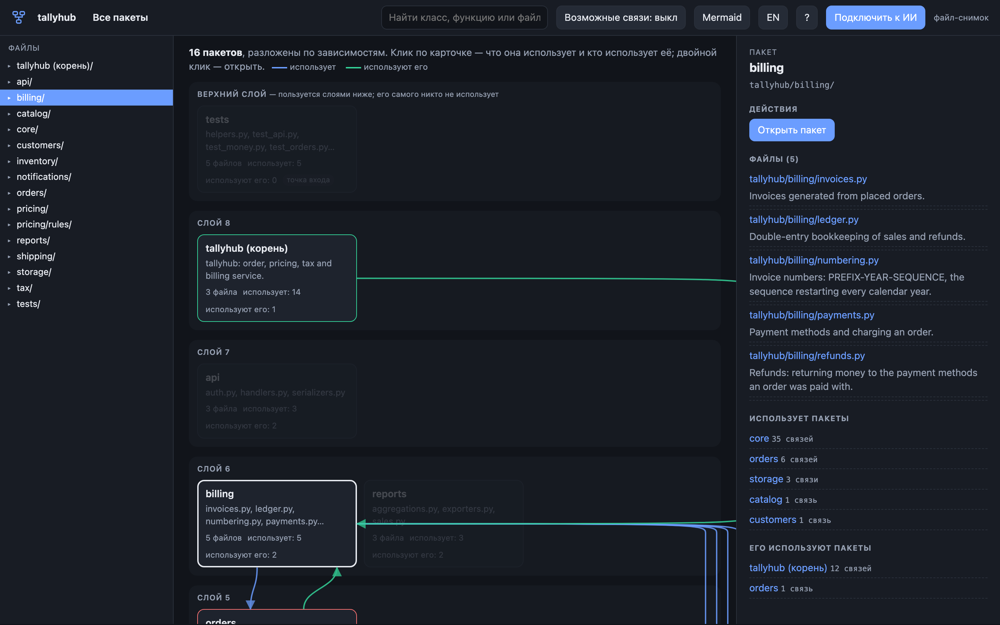
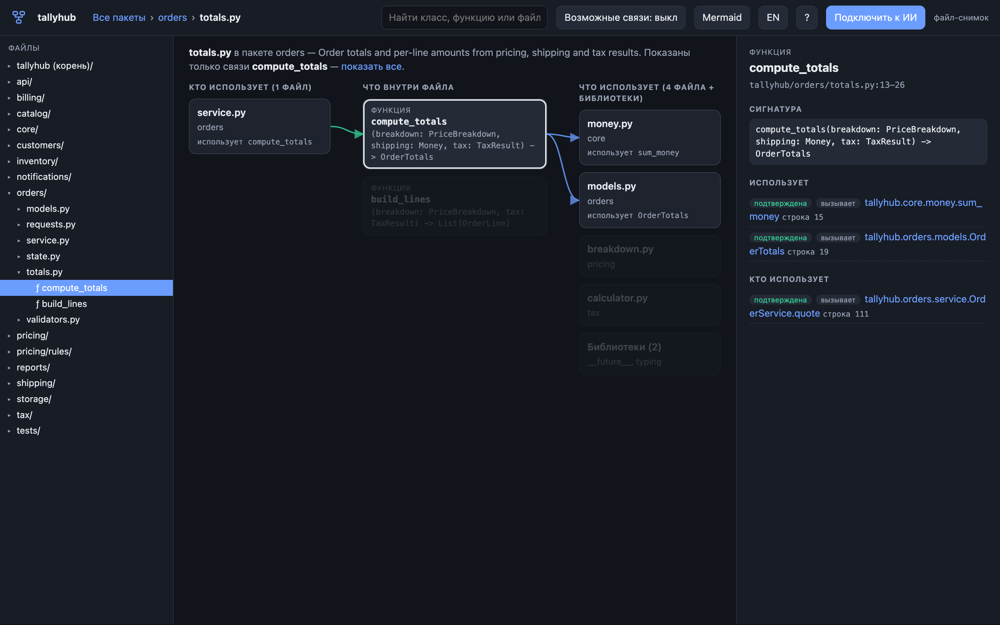
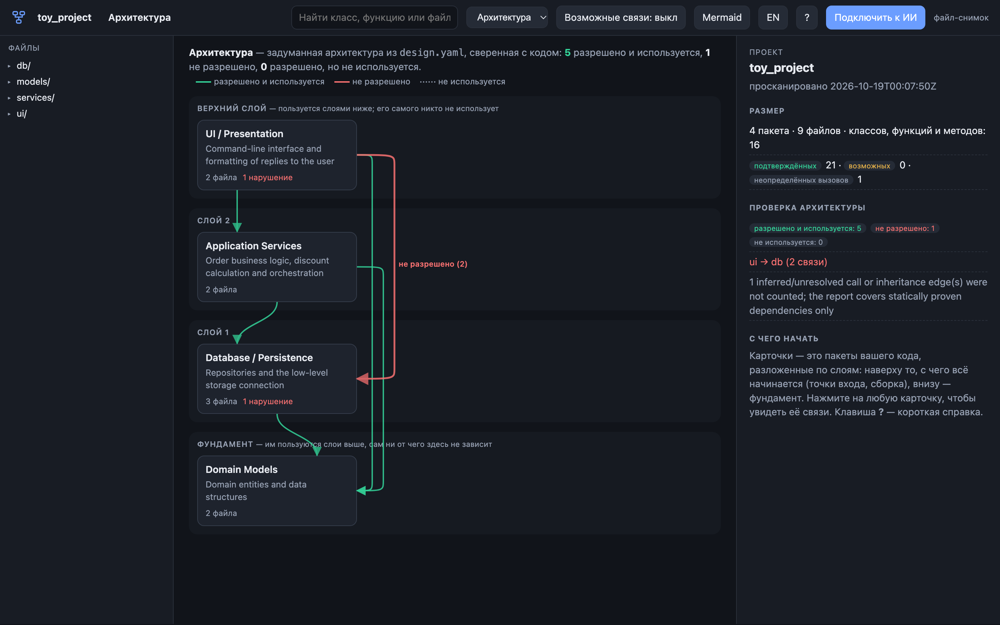

# Method Project Map — руководство пользователя

[English version](guide.en.md) · [К README](../README.ru.md) · [Method Network](https://method-network.com/)

Здесь описано, как установить Method Project Map, читать карту, проверять архитектуру, подключать ИИ-агентов, и перечислены все команды. В самой карте то же самое есть во встроенном виде: кнопка **?** открывает справочник и минутное обучение.

- [1. Установка](#1-установка)
- [2. Первый запуск](#2-первый-запуск)
- [3. Как читать карту](#3-как-читать-карту)
- [4. Проекты и что попадает на карту](#4-проекты-и-что-попадает-на-карту)
- [5. Проверка архитектуры через design.yaml](#5-проверка-архитектуры-через-designyaml)
- [6. ИИ-агенты](#6-ии-агенты)
- [7. Как поделиться картой](#7-как-поделиться-картой)
- [8. Справочник команд](#8-справочник-команд)
- [9. Если что-то не так](#9-если-что-то-не-так)
- [10. Удаление](#10-удаление)

## 1. Установка

Нужен **Python 3.9 или новее**. Больше ничего: инструмент использует только стандартную библиотеку и работает без интернета.

```bash
git clone https://github.com/lstcrsdd/method-project-map.git
cd method-project-map
```

| | macOS / Linux | Windows |
|---|---|---|
| Установить и подключить Claude Code (по умолчанию) | `./install.sh` | `install.bat` |
| Установить и подключить Codex | `./install.sh --codex` | `install.bat --codex` |
| Установить и подключить обоих агентов | `./install.sh --all` | `install.bat --all` |
| Установить без подключения агентов | `./install.sh --none` | `install.bat --none` |

Установщик:

1. копирует инструмент в `~/.pmap` и создаёт команду `pmap` в `~/.pmap/bin` (на Windows — `pmap.cmd`);
2. создаёт ярлык **Method Project Map**:
   - macOS — `~/Applications/Method Project Map.app` (находится через Spotlight и Launchpad);
   - Windows — пункт в меню «Пуск»;
   - Linux — пункт в меню приложений (`~/.local/share/applications/method-project-map.desktop`);
3. подключает выбранного ИИ-агента (см. [раздел 6](#6-ии-агенты)).

По желанию добавьте `~/.pmap/bin` в `PATH`, чтобы писать просто `pmap`.

**Без установки.** Карту можно запустить прямо из скачанной папки: двойной клик по `Method Project Map.command` (macOS) или `pmap-ui.bat` (Windows), либо `./pmap-ui.sh` (Linux, macOS).

## 2. Первый запуск

Откройте ярлык **Method Project Map** или выполните `pmap ui`.

- В первый раз появится окно выбора папки: какой проект показать (Finder на macOS, Проводник на Windows, системное окно на Linux).
- Дальше сразу открывается последний проект.
- Карта открывается в браузере. При первом заходе она предложит минутное обучение; пройти его снова можно в любой момент: **?** → **Пройти обучение**.
- Повторный запуск ярлыка не запускает вторую копию, а открывает уже работающую карту.
- Карта сама останавливается примерно через 15 минут после того, как закрыли её вкладку.

На macOS при первом запуске ярлыка система может спросить, можно ли *Method Project Map* читать файлы в папке проекта (например, на внешнем диске). Разрешите один раз.

Открыть конкретный проект из терминала: `pmap ui /путь/к/проекту`.

## 3. Как читать карту



### Три уровня

| Уровень | Карточка — это | Что видно |
|---|---|---|
| **Обзор** | пакет (папка с кодом) | все пакеты, разложенные по слоям |
| **Пакет** | файл пакета | файлы по слоям, плюс пакеты, которые он использует и которые используют его |
| **Файл** | класс или функция | три колонки: кто использует файл · что внутри · что использует он |

- **Клик** по карточке выбирает её и показывает связи.
- **Двойной клик** или кнопка **Открыть** в боковой панели — зайти внутрь.
- Путь вверху (*Все пакеты › billing › invoices.py*), `Esc` или `Backspace` — на уровень выше.
- Дерево **Файлы** слева открывает любой пакет, файл, класс или функцию.

### Слои

Карточки разложены по зависимостям:

- **верхний слой** пользуется слоями ниже, а его самого никто не использует: точки входа, командная строка, тесты;
- **фундамент** внизу ни от чего на экране не зависит: модели, утилиты, ядро;
- промежуточные слои опираются на те, что под ними.

Если код снизу пользуется кодом сверху, к архитектуре обычно стоит присмотреться.

### Стрелки и цвета

Стрелки рисуются **только для выбранной карточки**, чтобы картинка оставалась читаемой:

- **синие** — что использует выбранное;
- **зелёные** — кто использует выбранное;
- карточка в **красной** рамке и использует выбранное, и используется им (цикл);
- **жёлтый пунктир** — возможная связь (см. ниже).

Несвязанные карточки бледнеют. Клик по пустому месту снимает выбор.

### Внутри файла



В левой колонке — файлы, которые используют этот файл, в центре — его классы, функции и методы, справа — файлы, которые использует он (библиотеки свёрнуты в одну карточку). Нажмите на функцию или метод, чтобы оставить только **её собственных** вызывающих и вызываемых; **показать все** возвращает весь файл.

### Подтверждённые, возможные и неопределённые связи

Карта никогда не выдаёт догадку за факт. У каждой связи есть уровень уверенности:

| Метка | Значение | Что делать |
|---|---|---|
| **подтверждена** (`resolved`) | доказана по коду: прямой импорт, вызов импортированной функции, базовый класс | можно полагаться |
| **возможна** (`inferred`) | вероятна, но не доказана: вызов через параметр с аннотацией типа, метод, который может переопределить подкласс, переменная, которой присваивают в нескольких местах | проверить в коде; по умолчанию скрыты — включите **Возможные связи** |
| **не определена** (`unresolved`) | цель неизвестна | перечислены в боковой панели как *Вызовы, которые карта не смогла определить*; смотрите код |

Анализ статический и «закрытого мира»: карта не видит вызовов из кода вне репозитория, подмены функций на лету (monkey-patching) и обращений по имени через `getattr`.

### Боковая панель

Правая панель описывает выбранное: что это (первая строка docstring), сигнатура, что внутри, что оно использует и кто использует его — с номерами строк. Кнопки:

- **Открыть** — зайти внутрь;
- **Показать код** — код только этой функции или класса (в живой карте);
- **Показать в Finder / Проводнике** — файл в файловом менеджере (в живой карте).

### Поиск и клавиши

| Клавиша | Действие |
|---|---|
| `/` | поиск классов, функций, методов и файлов |
| `↑` `↓` `Enter` | выбрать и открыть результат поиска |
| `Esc`, `Backspace` | на уровень выше; закрыть окно |
| `→` `←` `Esc` | далее, назад и выход в обучении |

### Язык

Кнопка **RU / EN** в шапке переключает язык интерфейса, выбор запоминается. Описания из кода (docstrings) остаются как написаны.

## 4. Проекты и что попадает на карту

Нажмите на **название проекта** слева вверху, чтобы:

- выбрать другую папку в Finder / Проводнике;
- вставить полный путь к папке проекта;
- снова открыть один из недавних проектов;
- показать папку текущего проекта в Finder / Проводнике.

Подойдёт любая папка с Python-файлами. Домашнюю папку или диск целиком карта не откроет: выберите один проект.

**Корни импорта.** Раскладка с `src/` определяется автоматически. Для других раскладок один раз выполните `pmap scan . --root ПАПКА` (для нескольких корней повторите `--root`): сохранённая карта их запомнит.

**Что убрать с карты.** Сгенерированный или чужой (вендорный) код может заслонить настоящую структуру. Положите в корень проекта файл `.pmapignore`:

```text
# по шаблону на строку; / в конце исключает папку целиком
vendor/
generated/
*_pb2.py
```

**Свежесть.** Живая карта следит за файлами и обновляется, когда они меняются. Сохранённая карта (`.pmap/actual.json` от `pmap scan`) используется, только пока совпадает с файлами на диске; иначе проект сканируется заново. Устаревшая карта никогда не показывается молча.

## 5. Проверка архитектуры через design.yaml

Запишите задуманную архитектуру, и карта сверит с ней настоящий код (*Reflexion model*, Murphy & Notkin, 1995).

Положите `design.yaml` в корень проекта (подойдут и `.pmap/design.yaml`, `pmap.design.yaml`):

```yaml
pmf_version: "0.1.0"
kind: "design"
project:
  name: "shop"
  description: "Сервис заказов со слоистой архитектурой"

subsystems:
  - id: "ui"
    name: "Интерфейс"
    paths: ["app/ui/**"]
  - id: "services"
    name: "Бизнес-логика"
    paths: ["app/services/**"]
  - id: "db"
    name: "База данных"
    paths: ["app/db/**"]
  - id: "models"
    name: "Доменные модели"
    paths: ["app/models/**"]

allowed_dependencies:
  - from: "ui"
    to: "services"
  - from: "ui"
    to: "models"
  - from: "services"
    to: "db"
  - from: "services"
    to: "models"
  - from: "db"
    to: "models"
```

- `subsystems` — части системы; `paths` — шаблоны путей от корня проекта.
- `allowed_dependencies` — какая подсистема может пользоваться какой. Всё остальное запрещено.

После этого на карте появляется вид **Архитектура**:



- **зелёным** — разрешено и используется (*convergence*);
- **красным** — используется, но не разрешено (*divergence*), с файлом и строкой, откуда это взялось;
- **точками** — разрешено, но не используется (*absence*).

В терминале или в CI:

```bash
pmap check .              # отчёт
pmap check . --json       # отчёт для программ
pmap check . --strict     # код выхода 1 при нарушениях (для CI)
```

Учитываются только подтверждённые связи. Импорты только для проверки типов (`if TYPE_CHECKING:`) не учитываются, если не передать `--include-type-only`.

Рабочий пример лежит в [`examples/`](../examples): `pmap serve examples/toy_project --design examples/design.yaml --open` показывает одно нарочно заложенное нарушение (`ui → db`).

## 6. ИИ-агенты

Агенты тратят большую часть контекста на чтение файлов, просто чтобы сориентироваться. Method Project Map даёт им вместо этого карту.

### Что делает подключение

Кнопка **Подключить к ИИ** в карте, установщик или `pmap connect` настраивают:

| | Claude Code | Codex |
|---|---|---|
| Навык `project-map` (как пользоваться картой) | `~/.claude/skills/project-map/` | `~/.codex/skills/project-map/` |
| Обзор проекта в начале каждой сессии | хук `SessionStart` в `~/.claude/settings.json` | правило в `~/.codex/AGENTS.md` |
| Правило сначала смотреть карту, потом читать файлы | `~/.claude/CLAUDE.md` | `~/.codex/AGENTS.md` |
| MCP-сервер `pmap` | регистрируется через `claude mcp add --scope user` | `~/.codex/config.toml` |

Каждое изменение — помеченный блок; перед первым изменением у каждого файла настроек делается копия `<имя>.bak-pmap`. **Отключить** (или `pmap disconnect --all`) убирает ровно эти добавления.

Хук действует только в Python-проектах (ищет `.git`, `pyproject.toml`, `setup.py`, `requirements.txt` и подобное или папку с Python-пакетами). В остальных местах, в домашней папке и при любой ошибке он молчит.

### Как плагин

Вместо `pmap connect` можно поставить плагин из этого репозитория (в нём навык, хук, MCP-сервер и команда `pmap`):

```text
# Claude Code
/plugin marketplace add lstcrsdd/method-project-map
/plugin install project-map@method-project-map

# Codex
codex plugin marketplace add lstcrsdd/method-project-map
codex plugin add project-map
```

Используйте что-то одно — плагин или `pmap connect --claude`: каждый из них добавляет обзор в начале сессии.

### Что получает агент

В начале сессии — компактный обзор (около 8 000 символов): пакеты с назначением и зависимостями, затем файлы с описанием в одну строку, затем сигнатуры; самый используемый код идёт первым. Дальше — точечные запросы:

| Задача | Команда | Инструмент MCP |
|---|---|---|
| Обзор | `pmap context . --max-chars 8000` | `pmap_overview` |
| Где класс или функция (подсказывает похожие имена) | `pmap find ИМЯ` | `pmap_find` |
| Один элемент: где, сигнатура, связи, кто использует | `pmap show ССЫЛКА` | `pmap_show` |
| Код одной функции или класса вместо целого файла | `pmap source ССЫЛКА` | `pmap_source` |
| Проверка архитектуры | `pmap check .` | `pmap_check` |
| Что изменилось после сохранённого скана | `pmap stale .` | `pmap_stale` |
| Сохранить свежую карту | `pmap scan .` | `pmap_scan` |

`ССЫЛКА` — идентификатор узла (`sym:pkg.module:Class.method`, `mod:pkg.module`), путь к файлу или полное имя. Правила, которым следуют агенты, — в [AGENT_PROTOCOL.md](AGENT_PROTOCOL.md).

### Помогает ли это?

На проекте в 29 тысяч строк со скрытыми тестами Codex исправил 60 ошибок из 60 и с картой, и без неё. С обзором в промпте он прочитал **0,55×** кода (95% доверительный интервал 0,49–0,59) и написал 0,85× выходных токенов; входные токены в сумме — 0,93× (интервал 0,83–1,02, разница не значима). Агенты, которым о командах только *сообщили*, почти ими не пользовались, поэтому обзор подаётся в начале сессии. Подробности — в [bench/reports](../bench/reports).

## 7. Как поделиться картой

```bash
pmap html /путь/к/проекту -o map.html
```

сохраняет одну самодостаточную страницу: без сервера и без интернета, открывается из файла или с любого статического хостинга. Это снимок: смена проекта, показ кода и *Показать в Finder* работают только в живой карте.

Полезные параметры адреса для опубликованной страницы:

| Адрес | Что делает |
|---|---|
| `map.html?lang=ru` / `?lang=en` | язык интерфейса |
| `map.html?tour=0` | не предлагать обучение |
| `map.html#select=pkg:app/billing` | открыть с выбранным пакетом |
| `map.html#open=mod:app.billing.invoices` | открыть файл |
| `map.html#open=sym:app.billing.invoices:Invoice` | открыть класс или функцию |
| `map.html#view=design` | открыть вид «Архитектура» |

`pmap mermaid . --level subsystem|module` и кнопка **Mermaid** выгружают схемы в виде текста Mermaid для документации.

## 8. Справочник команд

Подробно о любой команде: `pmap <команда> --help`.

| Команда | Что делает | Основные параметры |
|---|---|---|
| `pmap ui [ПАПКА]` | открыть карту: эту папку, иначе последний проект, иначе спросить | `--port` |
| `pmap serve [ПАПКА]` | живая карта для разработки; работает, пока её не остановят | `--open`, `--port`, `--host`, `--design` |
| `pmap html [ПАПКА]` | сохранить самодостаточную страницу | `-o ФАЙЛ`, `--design` |
| `pmap scan ПАПКА` | сохранить карту в `.pmap/actual.json` | `--root ПАПКА` (можно несколько), `--output` |
| `pmap context ПАПКА` | текстовый обзор для ИИ-агента | `--max-chars N`, `--design` |
| `pmap find ИМЯ` | найти классы, функции, методы | `--repo`, `--limit` |
| `pmap show ССЫЛКА` | один узел со связями и пользователями | `--repo` |
| `pmap source ССЫЛКА` | исходный код одного узла | `--repo`, `--context N` |
| `pmap check ПАПКА` | сверить с `design.yaml` | `--design`, `--json`, `--strict`, `--include-type-only` |
| `pmap stale ПАПКА` | что изменилось после последнего скана | `--json` |
| `pmap mermaid ПАПКА` | схема Mermaid | `--level subsystem\|module`, `--design` |
| `pmap mcp` | MCP-сервер через stdio | `--repo` |
| `pmap connect` / `disconnect` | ИИ-агенты | `--claude`, `--codex`, `--all` |
| `pmap connection` | какие агенты подключены | |
| `pmap shortcut` | создать ярлык приложения | `--remove` |
| `pmap hook session-start` | вызывается хуком Claude Code | |

## 9. Если что-то не так

| Что видно | Почему и что делать |
|---|---|
| *остановлена — запустите Method Project Map снова* | карта остановилась, потому что её вкладка была закрыта или долго не отвечала; запустите снова |
| *В папке нет Python-файлов* | выберите саму папку проекта, а не ту, что выше или рядом |
| *Слишком широко…* | домашняя папка, диск или папка, где больше 20 000 Python-файлов; выберите один проект |
| macOS спрашивает доступ к файлам | разрешите один раз: ярлыку нужно читать папку проекта |
| Файла нет на карте | посмотрите *Файлы, которые карта не смогла прочитать* в панели проекта (ошибка синтаксиса) или проверьте `.pmapignore` |
| Нет ожидаемой связи | включите **Возможные связи**; вызовы через переменные, `getattr` или из кода вне репозитория доказать нельзя |
| Порт 8765 занят другой программой | ничего делать не нужно: карта возьмёт следующий свободный порт |
| Агент не получает обзор | `pmap connection` покажет, что подключено; хук действует только в Python-проектах |

## 10. Удаление

```bash
~/.pmap/bin/pmap disconnect --all     # убрать подключения агентов
~/.pmap/bin/pmap shortcut --remove    # убрать ярлык
rm -rf ~/.pmap                        # удалить инструмент (Windows: удалите папку %USERPROFILE%\.pmap)
```
